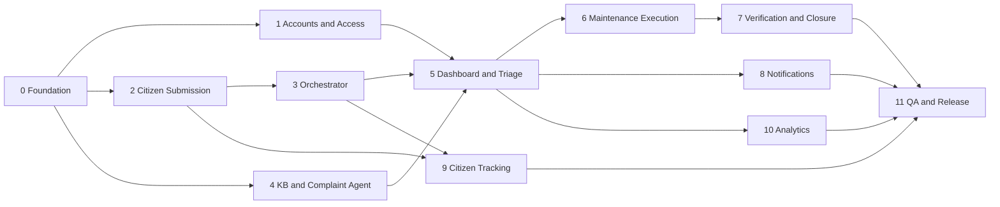

# Citizen Complaint Management System - Implementation Plan

| | |
|---|---|
| **Document** | Implementation Plan |
| **Version** | 2.0 |
| **Scope** | Full delivery plan: 12 phases, 33 user stories, traceable to story IDs |
| **Status** | Draft for project-owner review |

---

## 1. Purpose and Scope

This plan describes how the Citizen Complaint Management System is built, in which order, and which user stories each piece of work delivers. It turns the [project overview](./project_overview.md), the [system architecture](./system_architecture.md) and the four user story files into numbered phases and tasks with dependencies, deliverables and exit criteria.

**In scope:** citizen portal (submission and tracking), Supervisor Agent (Orchestrator), Complaint Agent with RAG, government dashboard, maintenance execution, verification and closure, dashboard in-app notifications, analytics.

**Out of scope (by decision):** in-app notifications for citizens, blocker reporting for maintenance teams, an admin UI for knowledge-base management, separation of duties between assigning and verifying, and dedicated PII-handling work beyond the existing PII-masking middleware.

---

## 2. Related Documents

| Document | Purpose |
|---|---|
| [project_overview.md](./project_overview.md) | Administration pitch and goals |
| [system_architecture.md](./system_architecture.md) | Components, status model, tool-call limits, JSON payload contracts |
| [citizen_user_stories.md](./citizen_user_stories.md) | Citizen stories `CIT-01` to `CIT-10` |
| [administrator_reviewer_user_stories.md](./administrator_reviewer_user_stories.md) | Super Administrator stories `SUP-01` to `SUP-03` and Administrator/Reviewer stories `ADM-01` to `ADM-15` |
| [maintenance_team_user_stories.md](./maintenance_team_user_stories.md) | Maintenance stories `MNT-01` to `MNT-05` |

---

## 3. Conventions

**Story IDs** are clickable links to the exact story in its file.

| Prefix | Persona | Count | File |
|---|---|---|---|
| `CIT` | Citizen | 10 | [citizen_user_stories.md](./citizen_user_stories.md) |
| `SUP` | Super Administrator | 3 | [administrator_reviewer_user_stories.md](./administrator_reviewer_user_stories.md) |
| `ADM` | Administrator / Authority Reviewer | 15 | [administrator_reviewer_user_stories.md](./administrator_reviewer_user_stories.md) |
| `MNT` | Maintenance Team Member | 5 | [maintenance_team_user_stories.md](./maintenance_team_user_stories.md) |

**Task IDs** use the form `<phase>.<task>` (for example `5.3` is task 3 of Phase 5).

**Statuses** follow the [status model](./system_architecture.md#status-model): ticket lifecycle `Pending → Approved → In Progress → Verifying → Done`, plus terminal `Declined` and `Dismissed`, and a rework loop `Verifying → In Progress`. Agent statuses (`Processing`, `Completed`, `Failed`) are internal.

---

## 4. Roadmap Overview

| Phase | Name | Stories delivered | Depends on |
|---|---|---|---|
| 0 | Foundation & Environment Setup | enabler (none) | none |
| 1 | Accounts, Roles & Access Control | [SUP-01](./administrator_reviewer_user_stories.md#sup-01), [SUP-02](./administrator_reviewer_user_stories.md#sup-02), [SUP-03](./administrator_reviewer_user_stories.md#sup-03) | 0 |
| 2 | Citizen Portal: Complaint Submission | [CIT-01](./citizen_user_stories.md#cit-01) to [CIT-08](./citizen_user_stories.md#cit-08) | 0 |
| 3 | Supervisor Agent (Orchestrator) | [CIT-09](./citizen_user_stories.md#cit-09) | 0, 2 |
| 4 | Knowledge Base & Complaint Agent | enabler for [ADM-03](./administrator_reviewer_user_stories.md#adm-03), [ADM-04](./administrator_reviewer_user_stories.md#adm-04), [ADM-05](./administrator_reviewer_user_stories.md#adm-05) | 0 |
| 5 | Government Dashboard & Triage | [ADM-01](./administrator_reviewer_user_stories.md#adm-01), [ADM-03](./administrator_reviewer_user_stories.md#adm-03) to [ADM-09](./administrator_reviewer_user_stories.md#adm-09) | 1, 3, 4 |
| 6 | Maintenance Execution | [MNT-01](./maintenance_team_user_stories.md#mnt-01), [MNT-03](./maintenance_team_user_stories.md#mnt-03), [MNT-04](./maintenance_team_user_stories.md#mnt-04) | 5 |
| 7 | Verification & Closure | [ADM-10](./administrator_reviewer_user_stories.md#adm-10) to [ADM-14](./administrator_reviewer_user_stories.md#adm-14), [MNT-05](./maintenance_team_user_stories.md#mnt-05) | 6 |
| 8 | In-App Notifications (dashboard only) | [ADM-02](./administrator_reviewer_user_stories.md#adm-02), [MNT-02](./maintenance_team_user_stories.md#mnt-02) | 5 |
| 9 | Citizen Tracking | [CIT-10](./citizen_user_stories.md#cit-10) | 2, 3 |
| 10 | Analytics & Reporting | [ADM-15](./administrator_reviewer_user_stories.md#adm-15) | 5 |
| 11 | QA, Hardening & Release | all stories | 0 to 10 |

**Milestones**

| Milestone | Phases | Outcome |
|---|---|---|
| M1 Platform ready | 0, 1 | Environments, data model, logins and department-scoped access |
| M2 Submission-to-analysis pipeline | 2, 3, 4 | A citizen submits, the Orchestrator validates, the Complaint Agent returns severity and recommendations |
| M3 Full human workflow | 5, 6, 7, 8 | Triage, assignment, execution, verification, closure and notifications |
| M4 Visibility and insight | 9, 10 | Citizen tracking and analytics |
| M5 Release | 11 | Tested, hardened, in production |

**Dependency graph** (Phases 2, 4 and 1 can run in parallel after Phase 0; Phases 8, 9 and 10 can run in parallel after their dependencies)

---

## 5. Phase Details

### Phase 0 - Foundation & Environment Setup

**Objective:** Establish the technical base every other phase relies on.
**Stories covered:** none (enabler).
**Depends on:** none.

| Task | Description |
|---|---|
| 0.1 | Set up repository, branching strategy, CI/CD pipeline, and dev / staging / production environments. |
| 0.2 | Define the data model: Ticket, User, Department, MaintenanceTeam, Attachment (citizen photos and proof of work), Notification, AuditLog, KnowledgeDocument. Include the ticket lifecycle enum (`Declined`, `Pending`, `Approved`, `Dismissed`, `In Progress`, `Verifying`, `Done`) and the agent status enum (`Processing`, `Completed`, `Failed`). |
| 0.3 | Provision file storage for images and reports, with type and size validation hooks. |
| 0.4 | Set up central logging and the audit-log infrastructure used by the Orchestrator and the dashboard. |
| 0.5 | Create a configuration layer for tunable values (tool-call limits, retry policy, timeouts, upload limits). |

**Deliverables:** running environments, schema migrations, storage bucket, logging pipeline.
**Exit criteria:** a "hello world" build deploys through CI to staging; the schema migrates cleanly; a test file uploads and downloads.

---

### Phase 1 - Accounts, Roles & Access Control

**Objective:** Let the Super Administrator onboard staff and restrict each person to their department.
**Stories covered:** [SUP-01](./administrator_reviewer_user_stories.md#sup-01), [SUP-02](./administrator_reviewer_user_stories.md#sup-02), [SUP-03](./administrator_reviewer_user_stories.md#sup-03).
**Depends on:** Phase 0.

| Task | Description | Stories |
|---|---|---|
| 1.1 | Implement authentication for dashboard users (Super Administrator, Administrator/Reviewer, Maintenance Team). | enabler |
| 1.2 | Define the role model and permission matrix for the three dashboard roles. | enabler |
| 1.3 | Build the account-management UI to create, edit and manage Administrator and Reviewer accounts. | [SUP-01](./administrator_reviewer_user_stories.md#sup-01) |
| 1.4 | Build account management for Maintenance Team accounts. | [SUP-02](./administrator_reviewer_user_stories.md#sup-02) |
| 1.5 | Implement department-role assignment (Water, Roads, Electricity, and so on) and enforce department scoping server-side on every ticket query. | [SUP-03](./administrator_reviewer_user_stories.md#sup-03) |

**Deliverables:** login, role-based access control, account-management screens.
**Exit criteria:** an admin assigned to "Water" cannot read or change tickets of another department, verified by automated tests.

---

### Phase 2 - Citizen Portal: Complaint Submission

**Objective:** Give citizens an accessible form that produces a complete, valid submission and a Ticket ID.
**Stories covered:** [CIT-01](./citizen_user_stories.md#cit-01), [CIT-02](./citizen_user_stories.md#cit-02), [CIT-03](./citizen_user_stories.md#cit-03), [CIT-04](./citizen_user_stories.md#cit-04), [CIT-05](./citizen_user_stories.md#cit-05), [CIT-06](./citizen_user_stories.md#cit-06), [CIT-07](./citizen_user_stories.md#cit-07), [CIT-08](./citizen_user_stories.md#cit-08).
**Depends on:** Phase 0.
**Reference:** [payload specification](./system_architecture.md#agent-state--payload-specifications).

| Task | Description | Stories |
|---|---|---|
| 2.1 | Build the responsive, accessible web form shell. | [CIT-01](./citizen_user_stories.md#cit-01) |
| 2.2 | Add the free-text complaint description field. | [CIT-02](./citizen_user_stories.md#cit-02) |
| 2.3 | Add the authority dropdown, populated from the Department list. | [CIT-03](./citizen_user_stories.md#cit-03) |
| 2.4 | Add location input: GPS coordinates or a map pin (`lat`, `lon`). | [CIT-04](./citizen_user_stories.md#cit-04) |
| 2.5 | Add Name and National ID fields, submitted over a secure connection. | [CIT-05](./citizen_user_stories.md#cit-05) |
| 2.6 | Add optional photo attachments (proposed defaults: JPEG/PNG, up to 5 images, 5 MB each) with preview and removal. | [CIT-06](./citizen_user_stories.md#cit-06) |
| 2.7 | Implement client-side and server-side validation of required fields (description, authority, location, name, National ID). Photos stay optional. | [CIT-07](./citizen_user_stories.md#cit-07) |
| 2.8 | Build the submission endpoint: store the ticket, generate the unique Ticket ID, build the JSON payload for the Orchestrator, and show a confirmation screen with the Ticket ID. | [CIT-08](./citizen_user_stories.md#cit-08) |

**Deliverables:** working form, submission API, Ticket ID confirmation page.
**Exit criteria:** blank required fields block submission with clear messages; a valid submission returns a unique Ticket ID such as `C123` and stores any attached photos.

---

### Phase 3 - Supervisor Agent (Orchestrator)

**Objective:** Build the central hub that validates, protects, orchestrates and routes every ticket.
**Stories covered:** [CIT-09](./citizen_user_stories.md#cit-09) (also routes tickets chosen in [CIT-03](./citizen_user_stories.md#cit-03)).
**Depends on:** Phases 0 and 2.
**Reference:** [Orchestrator and middleware](./system_architecture.md#high-level-architecture), [tool-call limiting](./system_architecture.md#tool-call-limiting).

| Task | Description | Stories |
|---|---|---|
| 3.1 | Receive the submission payload, validate its schema, and set the agent status to `Processing`. | enabler |
| 3.2 | Implement the validation step: check that required fields exist and that the complaint content matches the selected authority. On failure, set the ticket to `Declined` with a human-readable reason and stop. | [CIT-09](./citizen_user_stories.md#cit-09) |
| 3.3 | Implement middleware: Logging, PII masking, Tool Retry (transient errors only, exponential backoff with jitter), and Tool Call Limits (8 per ticket, 3 per tool, 15 s per tool, 60 s per ticket, loop guard, circuit breaker). | enabler |
| 3.4 | Hand valid tickets to the Complaint Agent using the input payload contract. | enabler |
| 3.5 | Handle the agent result and apply the status mapping: `Completed` becomes `Pending`; `Failed` becomes `Pending` with the flag "Needs manual review" and severity `Unclassified`. | enabler |
| 3.6 | Route the ticket into the selected authority's dashboard queue and write a routing entry to the audit log. | [CIT-03](./citizen_user_stories.md#cit-03) |

**Deliverables:** Orchestrator service, middleware, decline and routing logic, audit entries.
**Exit criteria:** a mismatched complaint (for example a water leak sent to "Electricity") is declined with a reason and never reaches a dashboard; a tool-limit breach still produces a routed `Pending` ticket flagged for manual review.

---

### Phase 4 - Knowledge Base & Complaint Agent

**Objective:** Produce category, severity, and policy-aligned recommendations for every valid ticket.
**Stories covered:** enabler for [ADM-03](./administrator_reviewer_user_stories.md#adm-03) (severity), [ADM-04](./administrator_reviewer_user_stories.md#adm-04) (manual-review flag) and [ADM-05](./administrator_reviewer_user_stories.md#adm-05) (recommendations and RAG context).
**Depends on:** Phase 0 (can run in parallel with Phases 1 to 3).

| Task | Description | Stories |
|---|---|---|
| 4.1 | Build the developer-managed ingestion pipeline for laws, policies and regulations (clean, chunk, index, version). There is no admin UI. | enabler for [ADM-05](./administrator_reviewer_user_stories.md#adm-05) |
| 4.2 | Implement the Categorization Tool (Water, Electricity, Roads, Garbage, and so on). | enabler |
| 4.3 | Implement the Severity Classifier Tool (Critical, Medium, Weak). | enabler for [ADM-03](./administrator_reviewer_user_stories.md#adm-03) |
| 4.4 | Implement the RAG Retrieval Tool returning excerpts with their sources (`rag_context`). | enabler for [ADM-05](./administrator_reviewer_user_stories.md#adm-05) |
| 4.5 | Implement the Recommendation Generator combining severity and retrieved regulations. | enabler for [ADM-05](./administrator_reviewer_user_stories.md#adm-05) |
| 4.6 | Implement the structured success and failure output contracts. | enabler for [ADM-04](./administrator_reviewer_user_stories.md#adm-04) |
| 4.7 | Build an evaluation set of sample complaints to measure category and severity accuracy and tune prompts. | enabler |

**Deliverables:** populated knowledge base, four agent tools, success and failure payloads.
**Exit criteria:** on the evaluation set, outputs follow the structured contract; every recommendation cites at least one retrieved source; failures return the `Failed` payload instead of raising errors.

---

### Phase 5 - Government Dashboard & Triage

**Objective:** Give department staff one place to see, understand and decide on tickets.
**Stories covered:** [ADM-01](./administrator_reviewer_user_stories.md#adm-01), [ADM-03](./administrator_reviewer_user_stories.md#adm-03), [ADM-04](./administrator_reviewer_user_stories.md#adm-04), [ADM-05](./administrator_reviewer_user_stories.md#adm-05), [ADM-06](./administrator_reviewer_user_stories.md#adm-06), [ADM-07](./administrator_reviewer_user_stories.md#adm-07), [ADM-08](./administrator_reviewer_user_stories.md#adm-08), [ADM-09](./administrator_reviewer_user_stories.md#adm-09).
**Depends on:** Phases 1, 3 and 4.

| Task | Description | Stories |
|---|---|---|
| 5.1 | Build the department-scoped ticket list with filters by status, category and severity. | [ADM-01](./administrator_reviewer_user_stories.md#adm-01) |
| 5.2 | Show a severity badge on each ticket and support sorting so Critical tickets appear first. | [ADM-03](./administrator_reviewer_user_stories.md#adm-03) |
| 5.3 | Show the "Needs manual review" flag and let the reviewer set category and severity manually on flagged tickets. | [ADM-04](./administrator_reviewer_user_stories.md#adm-04) |
| 5.4 | Build the ticket detail view: description, citizen photos, map location, citizen info. | [ADM-06](./administrator_reviewer_user_stories.md#adm-06) |
| 5.5 | Build the AI insights panel: recommendations and retrieved RAG context with sources. | [ADM-05](./administrator_reviewer_user_stories.md#adm-05) |
| 5.6 | Implement Approve (`Pending → Approved`) and Dismiss (`Pending → Dismissed`) actions. | [ADM-07](./administrator_reviewer_user_stories.md#adm-07) |
| 5.7 | Implement team assignment (`Approved → In Progress`) with a maintenance-team picker. | [ADM-08](./administrator_reviewer_user_stories.md#adm-08) |
| 5.8 | Implement the workflow state machine (see section 6) and a real-time status view across all department tickets. | [ADM-09](./administrator_reviewer_user_stories.md#adm-09) |

**Deliverables:** dashboard list and detail screens, triage actions, enforced state machine.
**Exit criteria:** invalid transitions (for example `Pending → Done`) are rejected by the server; each transition writes an audit entry.

---

### Phase 6 - Maintenance Execution

**Objective:** Let maintenance teams receive work and submit proof.
**Stories covered:** [MNT-01](./maintenance_team_user_stories.md#mnt-01), [MNT-03](./maintenance_team_user_stories.md#mnt-03), [MNT-04](./maintenance_team_user_stories.md#mnt-04).
**Depends on:** Phase 5.

| Task | Description | Stories |
|---|---|---|
| 6.1 | Build the task list showing only tasks assigned to the user's team, with location (map link) and description. | [MNT-01](./maintenance_team_user_stories.md#mnt-01) |
| 6.2 | Build proof upload: photos and/or a completion report. | [MNT-03](./maintenance_team_user_stories.md#mnt-03) |
| 6.3 | Implement the "Completed" action (`In Progress → Verifying`), requiring at least one proof item. | [MNT-04](./maintenance_team_user_stories.md#mnt-04) |

**Deliverables:** maintenance task screens and proof upload.
**Exit criteria:** a team sees only its own tasks; marking a task "Completed" moves the ticket to `Verifying` and makes the proof visible to the reviewer.

---

### Phase 7 - Verification & Closure

**Objective:** Close tickets only after human verification, including the rework loop.
**Stories covered:** [ADM-10](./administrator_reviewer_user_stories.md#adm-10), [ADM-11](./administrator_reviewer_user_stories.md#adm-11), [ADM-12](./administrator_reviewer_user_stories.md#adm-12), [ADM-13](./administrator_reviewer_user_stories.md#adm-13), [ADM-14](./administrator_reviewer_user_stories.md#adm-14), [MNT-05](./maintenance_team_user_stories.md#mnt-05).
**Depends on:** Phase 6.

| Task | Description | Stories |
|---|---|---|
| 7.1 | Build the "Verifying" queue for the department. | [ADM-10](./administrator_reviewer_user_stories.md#adm-10) |
| 7.2 | Build the evidence review screen with proof photos and completion reports. | [ADM-11](./administrator_reviewer_user_stories.md#adm-11) |
| 7.3 | Implement "Confirm" (`Verifying → Done`) to formally close the ticket. | [ADM-12](./administrator_reviewer_user_stories.md#adm-12) |
| 7.4 | Implement "Reject proof" with a short note (`Verifying → In Progress`). | [ADM-13](./administrator_reviewer_user_stories.md#adm-13) |
| 7.5 | Show the rejection note on the maintenance task and allow re-upload and a new "Completed" action. | [MNT-05](./maintenance_team_user_stories.md#mnt-05) |
| 7.6 | Verify permissions allow the same Administrator/Reviewer to assign and verify the same ticket, and cover this with a test. | [ADM-14](./administrator_reviewer_user_stories.md#adm-14) |
| 7.7 | Keep every rejection and resubmission in the ticket history and audit log. | enabler |

**Deliverables:** verification queue, confirm and reject actions, rework loop.
**Exit criteria:** a rejected ticket returns to `In Progress` with the note visible to the team; the rework loop can repeat; `Done` is reachable only through confirmation.

---

### Phase 8 - In-App Notifications (Dashboard Only)

**Objective:** Alert dashboard users to events that need action. Citizens are not notified in-app; they use the tracking page.
**Stories covered:** [ADM-02](./administrator_reviewer_user_stories.md#adm-02), [MNT-02](./maintenance_team_user_stories.md#mnt-02) (also delivers the notification part of [MNT-05](./maintenance_team_user_stories.md#mnt-05)).
**Depends on:** Phase 5.

| Task | Description | Stories |
|---|---|---|
| 8.1 | Build the notification service and data model (recipient, type, ticket, read state). | enabler |
| 8.2 | Implement triggers (table below). | [ADM-02](./administrator_reviewer_user_stories.md#adm-02), [MNT-02](./maintenance_team_user_stories.md#mnt-02), [MNT-05](./maintenance_team_user_stories.md#mnt-05) |
| 8.3 | Implement near-real-time delivery (WebSocket, server-sent events or polling), an unread badge and mark-as-read. | [ADM-02](./administrator_reviewer_user_stories.md#adm-02) |

| Event | Recipient | Story |
|---|---|---|
| Ticket routed to a department (`Pending`) | Administrators/Reviewers of that department | [ADM-02](./administrator_reviewer_user_stories.md#adm-02) |
| Ticket moved to `Verifying` | Administrators/Reviewers of that department | [ADM-02](./administrator_reviewer_user_stories.md#adm-02) |
| Ticket assigned to a team | Assigned maintenance team | [MNT-02](./maintenance_team_user_stories.md#mnt-02) |
| Proof rejected (back to `In Progress`) | Assigned maintenance team | [MNT-05](./maintenance_team_user_stories.md#mnt-05) |

**Exit criteria:** each event above produces exactly one notification to the right users and to nobody else.

---

### Phase 9 - Citizen Tracking

**Objective:** Let citizens follow their complaint using only the Ticket ID.
**Stories covered:** [CIT-10](./citizen_user_stories.md#cit-10).
**Depends on:** Phases 2 and 3.

| Task | Description | Stories |
|---|---|---|
| 9.1 | Build the tracking page: enter a Ticket ID and see the current status. | [CIT-10](./citizen_user_stories.md#cit-10) |
| 9.2 | Display all statuses, including `Declined` with its reason, `Dismissed`, and a return to `In Progress` after rejected proof. | [CIT-10](./citizen_user_stories.md#cit-10) |
| 9.3 | Limit what the page reveals to status, category and timestamps, and rate-limit lookups to prevent Ticket ID guessing. | enabler |

**Exit criteria:** every status in the lifecycle renders correctly; an unknown Ticket ID returns a neutral "not found" message.

---

### Phase 10 - Analytics & Reporting

**Objective:** Give administrators data-driven insight into department performance.
**Stories covered:** [ADM-15](./administrator_reviewer_user_stories.md#adm-15).
**Depends on:** Phase 5.

| Task | Description | Stories |
|---|---|---|
| 10.1 | Build the aggregation layer over tickets: counts by category, severity and status; time to close; rework rate. | enabler |
| 10.2 | Implement the Analytics AI that generates graphs, key numbers and written insights, scoped to the viewer's department. | [ADM-15](./administrator_reviewer_user_stories.md#adm-15) |
| 10.3 | Build the analytics page on the dashboard. | [ADM-15](./administrator_reviewer_user_stories.md#adm-15) |

**Exit criteria:** an administrator sees correct, department-scoped charts and a generated summary; figures match a manual count on seeded data.

---

### Phase 11 - QA, Hardening & Release

**Objective:** Prove the whole system works end to end and release it.
**Stories covered:** all 33.
**Depends on:** Phases 0 to 10.

| Task | Description |
|---|---|
| 11.1 | Unit and integration tests for each phase, run in CI. |
| 11.2 | End-to-end scenarios: (a) happy path to `Done`; (b) `Declined` at validation; (c) `Dismissed`; (d) agent failure leading to "Needs manual review"; (e) proof rejection loop; (f) department isolation. |
| 11.3 | Agent evaluation and tool-limit tests (limit breach, retries, loop guard, circuit breaker). |
| 11.4 | Security review: role-based access, upload validation, rate limiting, secure transport. |
| 11.5 | Load test of submission and the agent pipeline. |
| 11.6 | User acceptance testing with municipal staff, production deployment, monitoring and alerting, runbook and handover. |

**Exit criteria:** all end-to-end scenarios pass; no open critical or high defects; UAT sign-off.

---

## 6. Cross-Cutting Design: Ticket State Machine

Enforced server-side in Phase 5 and used by Phases 3, 6, 7 and 9.

| From | To | Actor | Trigger | Story |
|---|---|---|---|---|
| submission | `Declined` | Orchestrator | Validation fails (missing data or wrong authority) | [CIT-09](./citizen_user_stories.md#cit-09) |
| submission | `Pending` | Orchestrator | Agent `Completed`, or `Failed` with manual-review flag | enabler |
| `Pending` | `Approved` | Reviewer | Approve | [ADM-07](./administrator_reviewer_user_stories.md#adm-07) |
| `Pending` | `Dismissed` | Reviewer | Dismiss | [ADM-07](./administrator_reviewer_user_stories.md#adm-07) |
| `Approved` | `In Progress` | Reviewer | Assign maintenance team | [ADM-08](./administrator_reviewer_user_stories.md#adm-08) |
| `In Progress` | `Verifying` | Maintenance team | Mark "Completed" with proof | [MNT-04](./maintenance_team_user_stories.md#mnt-04) |
| `Verifying` | `Done` | Reviewer | Confirm proof | [ADM-12](./administrator_reviewer_user_stories.md#adm-12) |
| `Verifying` | `In Progress` | Reviewer | Reject proof with note | [ADM-13](./administrator_reviewer_user_stories.md#adm-13) |

Terminal states: `Declined`, `Dismissed`, `Done`.

---

## 7. Definition of Done (applies to every story)

1. Acceptance behavior in the story is demonstrably met.
2. Unit and integration tests pass in CI.
3. Role and department access rules are enforced server-side.
4. State changes write an audit-log entry.
5. Configurable values are not hard-coded.
6. Story, task and code are linked by the story ID.

---

## 8. Assumptions & Decisions Log

| # | Decision or assumption | Source |
|---|---|---|
| D1 | Agent statuses are separate from ticket statuses; agent `Completed` maps to `Pending` | Confirmed |
| D2 | `Verifying` state sits between `In Progress` and `Done` | Confirmed |
| D3 | Orchestrator declines tickets whose content does not match the selected authority | Confirmed |
| D4 | Tool-call limits follow best-practice defaults and are configurable | Delegated to design |
| D5 | Citizens track by Ticket ID in the portal; in-app notifications are dashboard-only | Confirmed |
| D6 | Photo attachments are optional | Confirmed |
| D7 | Knowledge base is fed and maintained by the developers | Confirmed |
| D8 | Extra PII-handling work is not a priority | Confirmed |
| D9 | Rejected proof returns the ticket to `In Progress` | Confirmed |
| D10 | No blocker reporting for maintenance teams | Confirmed |
| D11 | The same role may assign and verify | Confirmed |
| A1 | `Dismissed` is a terminal status | Assumption |
| A2 | `In Progress` starts when the reviewer assigns a team | Assumption |
| A3 | Required fields: description, authority, location, name, National ID | Assumption |
| A4 | Photo limits: JPEG/PNG, 5 images, 5 MB each | Assumption |
| A5 | Proof rejection includes a short note | Assumption, to confirm |
| A6 | "Completed" requires at least one proof item | Assumption |
| A7 | Tracking page shows only status, category and timestamps | Assumption |
| A8 | Reviewers can set category and severity manually on flagged tickets | Assumption derived from [ADM-04](./administrator_reviewer_user_stories.md#adm-04) |

---

## 9. Risks

| Risk | Impact | Mitigation |
|---|---|---|
| Wrong severity or category from the LLM | Misprioritized tickets | Human review of every ticket; manual override (task 5.3); evaluation set (task 4.7) |
| Tool failure or limit breach | Ticket stuck or lost | Fallback routes to `Pending` with "Needs manual review" (task 3.5) |
| False declines at the validation step | Frustrated citizens | Clear decline reason; resubmission; tune on the evaluation set |
| Outdated laws in the knowledge base | Non-compliant recommendations | Developer-owned update process with versioned ingestion (task 4.1) |
| Growth of stored photos | Storage cost | Upload limits (A4) and lifecycle policies on storage |

---

## 10. Traceability Matrix

| Story | Summary | Primary phase | Supporting | Tasks |
|---|---|---|---|---|
| [CIT-01](./citizen_user_stories.md#cit-01) | Submit via accessible web form | 2 | | 2.1 |
| [CIT-02](./citizen_user_stories.md#cit-02) | Free-text description | 2 | | 2.2 |
| [CIT-03](./citizen_user_stories.md#cit-03) | Select authority from dropdown | 2 | 3 | 2.3, 3.6 |
| [CIT-04](./citizen_user_stories.md#cit-04) | Provide location (GPS or map pin) | 2 | | 2.4 |
| [CIT-05](./citizen_user_stories.md#cit-05) | Submit Name and National ID | 2 | | 2.5 |
| [CIT-06](./citizen_user_stories.md#cit-06) | Attach photos | 2 | | 2.6 |
| [CIT-07](./citizen_user_stories.md#cit-07) | Required-field alerts | 2 | | 2.7 |
| [CIT-08](./citizen_user_stories.md#cit-08) | Receive unique Ticket ID | 2 | | 2.8 |
| [CIT-09](./citizen_user_stories.md#cit-09) | Declined with a clear reason | 3 | 9 | 3.2, 9.2 |
| [CIT-10](./citizen_user_stories.md#cit-10) | Track ticket by ID | 9 | | 9.1, 9.2 |
| [SUP-01](./administrator_reviewer_user_stories.md#sup-01) | Manage admin and reviewer accounts | 1 | | 1.3 |
| [SUP-02](./administrator_reviewer_user_stories.md#sup-02) | Manage maintenance team accounts | 1 | | 1.4 |
| [SUP-03](./administrator_reviewer_user_stories.md#sup-03) | Assign department roles | 1 | | 1.5 |
| [ADM-01](./administrator_reviewer_user_stories.md#adm-01) | Centralized department dashboard | 5 | 1 | 5.1 |
| [ADM-02](./administrator_reviewer_user_stories.md#adm-02) | In-app notifications | 8 | | 8.2, 8.3 |
| [ADM-03](./administrator_reviewer_user_stories.md#adm-03) | View AI severity | 5 | 4 | 5.2, 4.3 |
| [ADM-04](./administrator_reviewer_user_stories.md#adm-04) | "Needs manual review" flag | 5 | 3, 4 | 5.3, 3.5, 4.6 |
| [ADM-05](./administrator_reviewer_user_stories.md#adm-05) | View recommendations and RAG context | 5 | 4 | 5.5, 4.1, 4.4, 4.5 |
| [ADM-06](./administrator_reviewer_user_stories.md#adm-06) | Review full complaint details | 5 | | 5.4 |
| [ADM-07](./administrator_reviewer_user_stories.md#adm-07) | Approve or dismiss | 5 | | 5.6 |
| [ADM-08](./administrator_reviewer_user_stories.md#adm-08) | Assign maintenance team | 5 | | 5.7 |
| [ADM-09](./administrator_reviewer_user_stories.md#adm-09) | Track real-time status | 5 | | 5.8 |
| [ADM-10](./administrator_reviewer_user_stories.md#adm-10) | Verifying queue | 7 | | 7.1 |
| [ADM-11](./administrator_reviewer_user_stories.md#adm-11) | Review proof evidence | 7 | | 7.2 |
| [ADM-12](./administrator_reviewer_user_stories.md#adm-12) | Confirm proof and mark Done | 7 | | 7.3 |
| [ADM-13](./administrator_reviewer_user_stories.md#adm-13) | Reject proof with note | 7 | | 7.4 |
| [ADM-14](./administrator_reviewer_user_stories.md#adm-14) | Same role assigns and verifies | 7 | | 7.6 |
| [ADM-15](./administrator_reviewer_user_stories.md#adm-15) | Analytics and reports | 10 | | 10.2, 10.3 |
| [MNT-01](./maintenance_team_user_stories.md#mnt-01) | Receive assigned tasks | 6 | | 6.1 |
| [MNT-02](./maintenance_team_user_stories.md#mnt-02) | Assignment notification | 8 | | 8.2 |
| [MNT-03](./maintenance_team_user_stories.md#mnt-03) | Upload proof | 6 | | 6.2 |
| [MNT-04](./maintenance_team_user_stories.md#mnt-04) | Mark task Completed | 6 | | 6.3 |
| [MNT-05](./maintenance_team_user_stories.md#mnt-05) | See rejection and resubmit | 7 | 8 | 7.5, 8.2 |

**Coverage check:** 33 of 33 stories mapped (10 `CIT`, 3 `SUP`, 15 `ADM`, 5 `MNT`).
